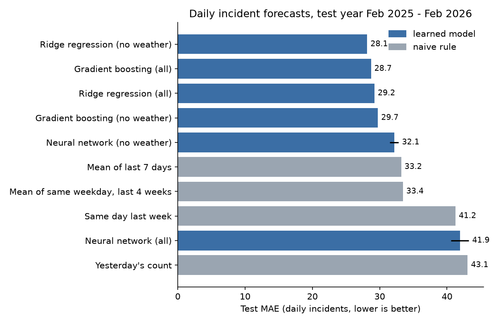

## Project Overview

This project models daily incident counts using time-series data enriched with calendar effects, named holidays, and weather conditions. The focus is not only on predictive performance but on interpretability: understanding which factors meaningfully influence incident volume and which ones are noise. In particular, the project is driven by the question of whether severe weather conditions such as heavy snow, storms, or ice risk have a larger and more reliable impact than mild or continuous effects like small temperature fluctuations.

The overall design emphasizes time safety, interpretability, and extensibility. All features are explicitly constructed rather than learned implicitly, no future information is used during training or feature creation, and the pipeline is structured to make systematic feature ablation straightforward. This allows model behavior to be explained in concrete, domain-relevant terms rather than treated as a black box.

## Repository Structure

The scripts directory contains the core pipeline. The build_features.py script constructs the full modeling dataset from raw daily incident counts, weather data, and calendar information. It generates lagged features, rolling averages, day-of-week encodings, named holiday windows, tiered weather severity indicators, compound danger proxies such as ice risk and blowing snow, and short-term weather streak features. All derived features are computed using past data only to avoid leakage.

The train_nn.py script trains and evaluates a neural network model on the engineered feature set. It uses a time-based train, validation, and test split, robust feature scaling, early stopping based on validation performance, and Huber loss to reduce sensitivity to extreme errors. Test performance is evaluated exactly once using the best validation model, and optional plots are generated for inspection.

The data directory is expected to contain raw input files such as daily_counts.csv and weather_daily.csv, as well as generated outputs like features_daily.csv and test_predictions_nn.csv. These files are intentionally not committed to version control and are regenerated locally. The plots directory holds generated visualizations produced during training or evaluation.

The main.py script runs the feature ablation in two stages. In the selection stage it trains the baseline model and one model per removed weather feature or feature group, each over five seeds, and ranks every run by validation MAE only; the test set is never scored, so it cannot influence which features are kept. Each removal is compared to the baseline seed by seed, and a change is flagged as real only when it exceeds two standard errors. In the evaluation stage it scores the test set exactly once, for two configurations: the all-features baseline and the run with the best validation MAE, reported next to naive baselines. Results go to data/ablation_results.csv (validation ranking) and data/final_test_results.csv (test scores).

The compare_models.py script puts the neural network next to naive rules (yesterday, last week, 7-day mean, same-weekday mean), ridge regression, and gradient boosting, each with and without weather features, on the same split. It writes data/model_comparison.csv, plots/model_comparison.png, and data/ridge_weather_ablation.csv.

## Typical Workflow

Set up the environment with Python 3.12: `python3.12 -m venv .venv && .venv/bin/pip install -r requirements.txt`. Place the raw input files in the data directory, build the feature table with `.venv/bin/python scripts/build_features.py`, train a single baseline model with `.venv/bin/python scripts/train_nn.py`, run the neural-network ablation with `.venv/bin/python main.py` (about ten minutes on a laptop CPU), and compare all models with `.venv/bin/python -m scripts.compare_models` (about a minute).

## Results

Test year: 2025-02-05 to 2026-02-04 (365 days); daily counts in this period average about 536. Every model below was fixed before the test year was scored: naive rules have no parameters, ridge and gradient boosting chose hyperparameters on validation, and the neural network is averaged over five seeds. Produced by `scripts/compare_models.py`.

| Model | Features | Validation MAE | Test MAE |
|---|---|---|---|
| Ridge regression | all | **29.59** | 29.21 |
| Gradient boosting | all | 29.83 | 28.70 |
| Ridge regression | no weather | 31.35 | 28.13 |
| Gradient boosting | no weather | 31.67 | 29.72 |
| Neural network | no weather | 35.80 | 32.15 (sd 0.67) |
| Mean of same weekday, last 4 weeks | - | 35.92 | 33.45 |
| Mean of last 7 days | - | 36.92 | 33.19 |
| Neural network | all | 40.50 | 41.91 (sd 1.33) |
| Yesterday's count | - | 44.08 | 43.06 |
| Same day last week | - | 47.03 | 41.25 |

**The model you would actually pick** is the one with the best validation score, ridge regression on all features. Its test error is 29.2 incidents a day, about 5.5% of a typical day and 12% better than the best naive rule (a 7-day average, 33.2).

**Simple models beat the neural network.** With about 2,700 training days and 58 features, ridge and gradient boosting outperform the network by 3 to 13 points. The network with every feature is no better than guessing last week's count. On a dataset this size, its extra flexibility mostly goes into fitting noise.

**Weather helps a little, but not reliably.** On validation, both ridge and gradient boosting do better with weather (by about 1.8 MAE). On the test year the picture is mixed: weather helps gradient boosting and slightly hurts ridge. Weather carries some signal, but it is small next to the calendar and recent-trend features, and its value shifts between periods.

**No single weather variable matters; weather as a block does.** Repeating the weather ablation with ridge (`data/ridge_weather_ablation.csv`), removing all weather costs 1.8 MAE on validation, but removing any one group (temperature, precipitation, snow, flags, compound danger proxies, streaks) costs at most 0.15. The groups overlap heavily, so each can stand in for the others. This includes the severe-weather indicators: removing all 17 of them together costs 0.11.

### Why the neural network struggles with weather

The neural-network ablation (`main.py`, results in `data/ablation_results.csv`) tells a different story from ridge, and the difference is about the model rather than the data. For the network, removing all weather improves validation MAE by 4.7, and raw temperature is the clearest culprit: removing the three temperature columns improves it by 3.6. Ridge, by contrast, is indifferent to those columns. The network appears to lean on temperature as a stand-in for season and then misfires when a year's temperatures don't follow the training pattern. The only weather features whose removal reliably hurts the network are the threshold flags, especially rain, which seem to offset part of that damage.

Earlier versions of this project ranked features by test MAE, which let the test set leak into feature selection, and left six compound and streak weather columns out of the ablation. Both are fixed.

**Limitations.** The validation window is a single half-year (August 2024 to February 2025), so selection never sees spring or summer; rolling-origin validation would be more robust, and the gap between validation and test rankings above is a sign of that. Weather features use each day's observed weather, which a real forecast would only know approximately. Flagging 47 neural-network comparisons at two standard errors will produce a few false positives.

## Modeling Philosophy

This project intentionally avoids end-to-end black-box approaches, opaque learned representations, and random cross-validation schemes that break the temporal structure of the data. Instead, it relies on explicit feature engineering, domain-informed thresholds for weather severity, and ablation-based evaluation to understand model behavior. Feature usefulness is assessed by observing how model performance changes when information is removed, rather than by relying on coefficients or internal network weights alone.

## Insights Enabled

The structure of the pipeline makes it possible to answer concrete questions about the data-generating process. It allows you to test whether heavy snow days matter more than temperature anomalies, whether rain-related features add value beyond snow indicators, whether compound danger conditions outperform raw weather measurements, and which weather variables actively degrade model performance when included. These insights are suitable for operational decision-making, policy discussion, or explanatory reporting to non-technical audiences.

## Reproducibility and Extensions

All experiments are reproducible due to fixed random seeds, deterministic transformations, and pinned dependencies in requirements.txt (verified to reproduce the original February 2026 numbers exactly). No derived data needs to be stored permanently, as all outputs can be regenerated from raw inputs. The project is designed to be extended easily, with natural next steps including seasonal interaction effects, weekday versus weekend differentiation, SHAP-style analysis layered on top of ablation results, or higher-resolution modeling if finer-grained incident data becomes available.

