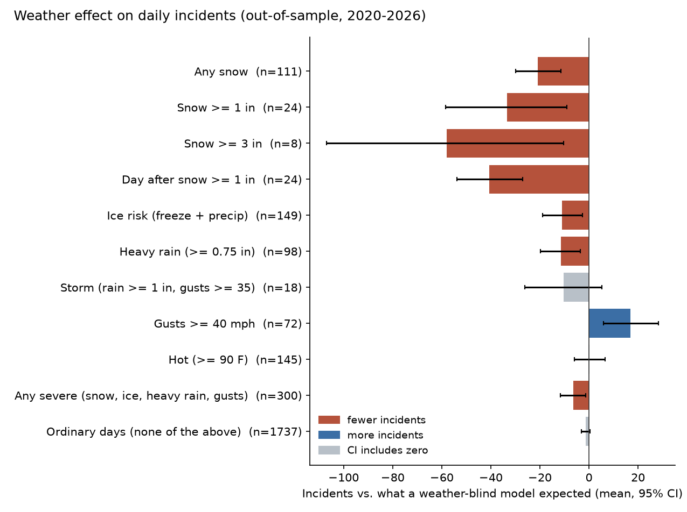
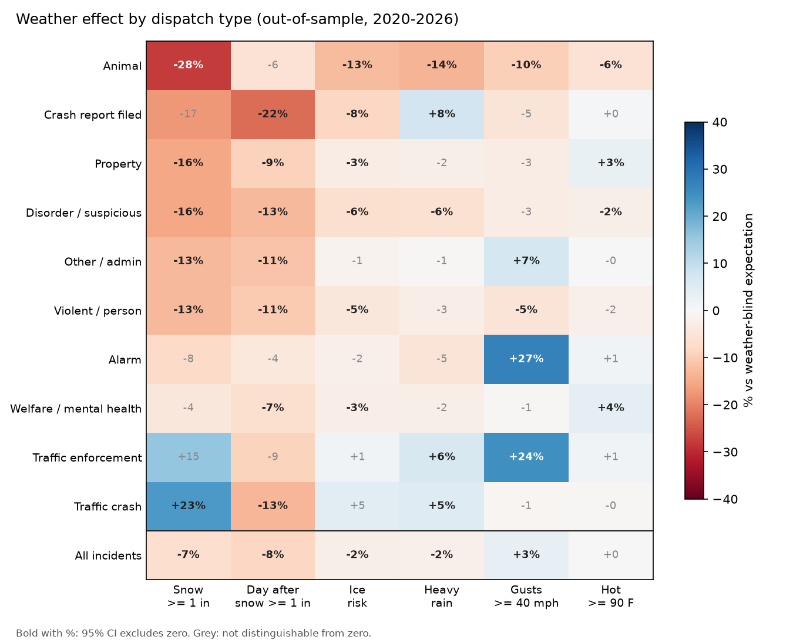
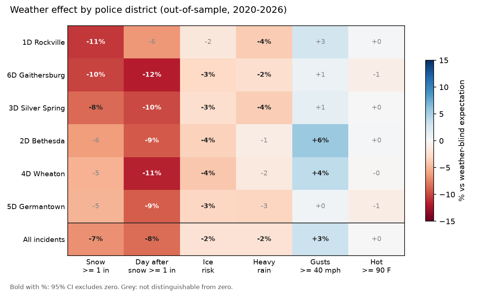
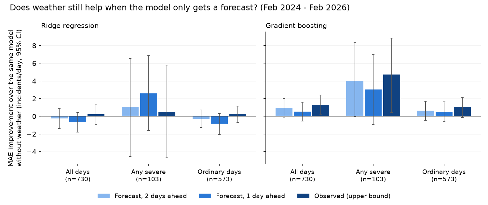
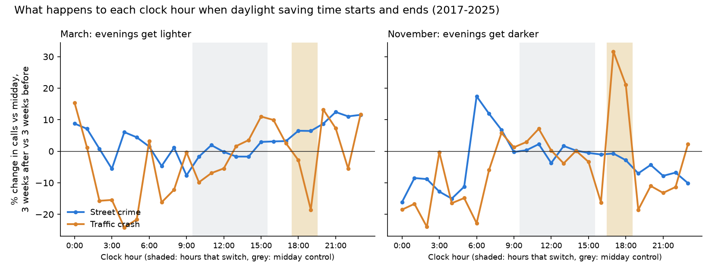
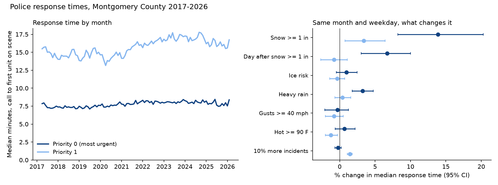

## Project Overview

This project models daily incident counts using time-series data enriched with calendar effects, named holidays, and weather conditions. The focus is not only on predictive performance but on interpretability: understanding which factors meaningfully influence incident volume and which ones are noise. In particular, the project is driven by the question of whether severe weather conditions such as heavy snow, storms, or ice risk have a larger and more reliable impact than mild or continuous effects like small temperature fluctuations.

The overall design emphasizes time safety, interpretability, and extensibility. All features are explicitly constructed rather than learned implicitly, no future information is used during training or feature creation, and the pipeline is structured to make systematic feature ablation straightforward. This allows model behavior to be explained in concrete, domain-relevant terms rather than treated as a black box.

## Repository Structure

The scripts directory contains the core pipeline. The build_features.py script constructs the full modeling dataset from raw daily incident counts, weather data, and calendar information. It generates lagged features, rolling averages, day-of-week encodings, named holiday windows, tiered weather severity indicators, compound danger proxies such as ice risk and blowing snow, and short-term weather streak features. All derived features are computed using past data only to avoid leakage.

The train_nn.py script trains and evaluates a neural network model on the engineered feature set. It uses a time-based train, validation, and test split, robust feature scaling, early stopping based on validation performance, and Huber loss to reduce sensitivity to extreme errors. Test performance is evaluated exactly once using the best validation model, and optional plots are generated for inspection.

The data directory is expected to contain raw input files such as daily_counts.csv and weather_daily.csv, as well as generated outputs like features_daily.csv and test_predictions_nn.csv. These files are intentionally not committed to version control and are regenerated locally. The plots directory holds generated visualizations produced during training or evaluation.

The main.py script runs the feature ablation in two stages. In the selection stage it trains the baseline model and one model per removed weather feature or feature group, each over five seeds, and ranks every run by validation MAE only; the test set is never scored, so it cannot influence which features are kept. Each removal is compared to the baseline seed by seed, and a change is flagged as real only when it exceeds two standard errors. In the evaluation stage it scores the test set exactly once, for two configurations: the all-features baseline and the run with the best validation MAE, reported next to naive baselines. Results go to data/ablation_results.csv (validation ranking) and data/final_test_results.csv (test scores).

The compare_models.py script puts the neural network next to naive rules (yesterday, last week, 7-day mean, same-weekday mean), ridge regression, and gradient boosting, each with and without weather features, on the same split. It writes data/model_comparison.csv, plots/model_comparison.png, and data/ridge_weather_ablation.csv.

The severe_weather.py script runs rolling-origin evaluation over six one-year windows (February 2020 to February 2026), training ridge and gradient boosting with and without weather on all data before each window. It then measures, for each weather category, how far incidents departed from the weather-blind prediction, with bootstrap confidence intervals. It writes data/rolling_origin_mae.csv, data/severe_weather_effects.csv, and plots/severe_weather_effect.png.

The make_category_series.py script maps every dispatch type to one of nine categories (traffic crash, traffic enforcement, alarm, violent/person, property, disorder/suspicious, welfare/mental health, animal, other) and builds daily counts per category, plus a count of incidents with a crash report attached. The weather_by_type.py script reruns the rolling-origin weather analysis for each category and draws the heatmap above (data/weather_effects_by_type.csv, plots/weather_effects_by_type.png). The same script writes daily counts by police district, and weather_by_district.py runs the analysis per district with a call-mix composition check and a within-day heterogeneity test (data/weather_effects_by_district.csv, data/district_composition_check.csv, data/district_heterogeneity.csv, plots/weather_effects_by_district.png).

The fetch_weather_forecast.py script downloads the day-ahead forecasts Open-Meteo actually issued (one and two days ahead, January 2024 onward). The forecast_weather.py script rescores the last two rolling-origin years with forecast instead of observed weather (data/forecast_vs_observed.csv, data/forecast_event_skill.csv, plots/forecast_vs_observed.png). Same-day weather flags are defined once in weather_features.py and shared by the observed and forecast feature builds.

The make_incident_extract.py script writes a call-level table (time, category, priority, response times) for the questions beyond weather. darkness_dst.py tests darkness at the daylight saving changes (data/darkness_dst_effects.csv, plots/darkness_dst.png), response_times.py models police response times (data/response_time_effects.csv, data/response_time_monthly.csv, plots/response_times.png), and full_moon.py tests the full-moon myth (data/full_moon_effects.csv). astro.py computes sunset times and moon phases. Further questions are ranked in docs/ROADMAP.md.

## Typical Workflow

Set up the environment with Python 3.12: `python3.12 -m venv .venv && .venv/bin/pip install -r requirements.txt`. Place the raw input files in the data directory, build the feature table with `.venv/bin/python scripts/build_features.py`, train a single baseline model with `.venv/bin/python scripts/train_nn.py`, run the neural-network ablation with `.venv/bin/python main.py` (about ten minutes on a laptop CPU), compare all models with `.venv/bin/python -m scripts.compare_models` (about a minute), run the severe-weather analysis with `.venv/bin/python -m scripts.severe_weather` (about a minute), and break it down by dispatch type with `.venv/bin/python scripts/make_category_series.py` followed by `.venv/bin/python -m scripts.weather_by_type` and `.venv/bin/python -m scripts.weather_by_district`. Check the forecast case with `cd scripts && ../.venv/bin/python fetch_weather_forecast.py` and then, from the repo root, `.venv/bin/python -m scripts.forecast_weather` (about 30 seconds). For the questions beyond weather, run `.venv/bin/python -m scripts.make_incident_extract` once (about a minute), then `.venv/bin/python -m scripts.darkness_dst`, `.venv/bin/python -m scripts.response_times` (about a minute and a half) and `.venv/bin/python -m scripts.full_moon`.

## Results

The data are police dispatch incidents in Montgomery County, Maryland, from May 2017 to February 2026, about 534 a day on average.

### Does severe weather matter? Yes, snow most of all

Rolling-origin evaluation gives every day from February 2020 to February 2026 (2,190 days) an out-of-sample prediction: six consecutive one-year windows, each predicted by models trained only on earlier data (`scripts/severe_weather.py`). For each weather category, the bar shows how far actual incidents fell from a ridge model that knows the calendar and recent history but not the weather. That gap is the estimated weather effect.

| Weather | Days | Effect vs weather-blind model | 95% CI | % of expected |
|---|---|---|---|---|
| Any snow | 111 | -20.9 | -29.8 to -11.5 | -4.2% |
| Snow >= 1 in | 24 | -33.3 | -58.5 to -9.1 | -6.9% |
| Snow >= 3 in | 8 | -57.9 | -107.0 to -10.3 | -12.0% |
| Day after snow >= 1 in | 24 | -40.7 | -53.9 to -27.1 | -8.4% |
| Ice risk (freeze + precipitation) | 149 | -11.0 | -18.9 to -2.6 | -2.2% |
| Heavy rain (>= 0.75 in) | 98 | -11.4 | -19.8 to -3.6 | -2.1% |
| Wind gusts >= 40 mph | 72 | +16.8 | +6.0 to +28.3 | +3.3% |
| Hot (>= 90 F) | 145 | +0.1 | -5.8 to +6.6 | 0.0% |
| Ordinary days | 1,737 | -1.3 | -3.1 to +0.3 | -0.2% |

- **Snow has a clear dose-response effect.** Incidents fall about 4% on any snow day, 7% at an inch or more, and 12% at three inches or more. The drop lasts into the next day (-8%), presumably as roads stay bad and people stay home.
- **Ice and heavy rain** each cut incidents by about 2%.
- **High winds go the other way**, about 3% more incidents on days with gusts of 40 mph or more. This analysis can't say why; downed trees, power outages, and alarms are plausible.
- **Mild variation does nothing.** Hot days and ordinary days sit on zero. This answers the project's starting question: severe weather has a real, measurable effect, and continuous small fluctuations do not.
- **Why weather barely moves the yearly error.** Severe days are about 14% of the year, and most effects are 2 to 4%. Gradient boosting with weather features does capture the snow effect, cutting its error on 3-inch snow days by 18 incidents (CI 5 to 31). Spread over a whole year, that's a rounding error. Ridge's linear terms mostly miss the snow-day drop but catch the day-after effect through the streak features (+10 MAE on those days, CI 2 to 19). Gradient boosting's version is in `data/severe_weather_effects.csv`; it finds the same pattern with slightly larger effects.

### Which incidents does weather move?

The total hides opposite movements underneath. `scripts/make_category_series.py` maps all 233 dispatch types into nine categories with explicit rules (the full mapping is in `data/dispatch_type_map.csv`). `scripts/weather_by_type.py` then repeats the rolling-origin analysis for each category, using that category's own history. As a check, its "All incidents" row reproduces the aggregate results above exactly.

- **Snow suppresses crime and disorder.** On days with an inch or more of snow, property, disorder, and violent/person calls each fall 13 to 16%, and animal calls 28%. The drop carries into the next day.
- **Snow raises crash calls but not serious crashes.** Traffic-crash calls rise 23% on snow days. Only 25% of those calls end with a crash report, though, against 38% on ordinary days, and the count of filed crash reports falls (17% on the day, not significant with 24 days; 22% the next day, significant). The extra calls look like slide-offs and stuck vehicles; fewer people on the road means fewer serious collisions.
- **Wind's effect is mostly alarms.** Alarm calls rise 27% on days with gusts of 40 mph or more, which accounts for most of the 3% rise in total incidents on those days. Calls dispatched as traffic violations also rise 24% on gusty days; the data can't say why.
- **Heat barely registers.** On 90-degree days the shifts are small: welfare and mental-health calls up 4%, property up 3%, animal calls down 6%, and the total unchanged.

These are 66 comparisons at 95% confidence, so expect a few of the smaller bold cells to be chance. The large effects (snow on crime, wind on alarms, snow on crash calls) are far outside that range.

### Does weather hit some districts harder?

`scripts/weather_by_district.py` repeats the rolling-origin analysis for each of the county's six police districts, each with its own history. It looks like the effects vary, with snow cutting incidents 11% in Rockville and 5% in Germantown. But the districts share the same days, so their confidence intervals can't simply be compared side by side. The bold/grey split above invites exactly that mistake. A proper test compares each district with the six-district average on the same day, relative to how that district runs on ordinary days, and bootstraps over days (`data/district_heterogeneity.csv`).

| Weather | Days | Districts differ? (p) | Smallest difference the test could detect |
|---|---|---|---|
| Any snow | 111 | 0.60 | about 2 points |
| Snow >= 1 in | 24 | 0.54 | about 4.5 points |
| Day after snow >= 1 in | 24 | 0.63 | about 5 points |
| Ice risk | 149 | 0.54 | about 2 points |
| Heavy rain | 98 | 0.36 | about 2 points |
| Gusts >= 40 mph | 72 | 0.09 | about 3 points |
| Hot | 145 | 0.54 | about 2 points |

- **No district responds differently by more than chance.** For the common weather types the test could detect a district departing from the county pattern by about 2 percentage points, and none does. For snow of an inch or more it could only detect a gap of about 4.5 points, so smaller real differences can't be ruled out.
- **The closest call, wind, follows the call mix.** Gusty days raise Bethesda's incidents 6% and Germantown's not at all (p = 0.09, the lowest of ten tests). Bethesda's calls are 15% alarms against 6 to 9% elsewhere, and wind mainly raises alarm calls. Applying the countywide effect for each dispatch type to each district's mix predicts Bethesda's gust effect at +4.7%, the highest of the six (`data/district_composition_check.csv`).
- **Call mixes are otherwise similar enough** that composition predicts nearly the same snow effect everywhere (-7% to -8.5%).
- One caveat: weather is measured at one point, and upcounty districts often get more snow than the center of the county. If anything that should make Germantown's snow drop look *larger*, and it looks smaller (not significantly).

### Which model to use

Single test year, 2025-02-05 to 2026-02-04 (`scripts/compare_models.py`). Every model was fixed before the test year was scored: naive rules have no parameters, ridge and gradient boosting chose hyperparameters on validation, and the neural network is averaged over five seeds.

| Model | Features | Validation MAE | Test MAE |
|---|---|---|---|
| Ridge regression | all | **29.44** | 28.86 |
| Gradient boosting | all | 29.46 | 29.57 |
| Ridge regression | no weather | 31.35 | 28.13 |
| Gradient boosting | no weather | 31.67 | 29.72 |
| Neural network | no weather | 35.80 | 32.15 (sd 0.67) |
| Mean of same weekday, last 4 weeks | - | 35.92 | 33.45 |
| Mean of last 7 days | - | 36.92 | 33.19 |
| Neural network | all | 40.23 | 40.99 (sd 0.95) |
| Yesterday's count | - | 44.08 | 43.06 |
| Same day last week | - | 47.03 | 41.25 |

One test year is a thin basis for choosing between close models; on this one, ridge without weather happens to score best. Averaged over the six rolling-origin windows (`data/rolling_origin_mae.csv`), the ranking is clearer:

| Model | Mean MAE, 6 yearly windows | Windows won vs. no-weather version |
|---|---|---|
| **Ridge regression, all features** | **28.3** | 3 of 6 (1 tie) |
| Ridge regression, no weather | 28.6 | |
| Gradient boosting, all features | 31.0 | 5 of 6 |
| Gradient boosting, no weather | 31.2 | |
| Mean of last 7 days | 32.8 | |

**Ridge regression with all features is the model to use:** about 28 incidents a day of error, roughly 5% of a typical day and 14% better than a 7-day average. Gradient boosting matches it in recent years but breaks down in the 2020 window (MAE 46.5), when it had only three years of pre-pandemic history to learn from.

**Simple models beat the neural network.** With about 2,700 training days, ridge and gradient boosting beat the network by 2 to 13 points. The network with every feature does no better than guessing last week's count.

**Weather helps as a block, not variable by variable.** Repeating the weather ablation with ridge (`data/ridge_weather_ablation.csv`), removing all weather costs 2.0 MAE on validation, but removing any single group (temperature, precipitation, snow, wind, flags, compound proxies, streaks) costs at most 0.2. The groups overlap, so each can stand in for the others.

### Does it still work with a real forecast?

Every result above feeds the model the weather that was *observed* on the day it predicts, which no one has in advance. Open-Meteo archives the forecasts it actually issued, with precipitation, snow, and gusts from January 2024 onward. `scripts/fetch_weather_forecast.py` pulls the forecasts issued one and two days ahead. `scripts/forecast_weather.py` rescores the last two rolling-origin years (February 2024 to February 2026, 730 days) with the same fitted models, swapping only the same-day weather inputs. Past weather (streaks, 30-day normals) stays observed, since a forecaster knows yesterday's weather. "Severe days" are always defined by what was observed.

MAE improvement from adding weather, compared with the same model without weather (95% CI):

| Days | Model | Forecast, 2 days ahead | Forecast, 1 day ahead | Observed |
|---|---|---|---|---|
| All days (730) | Ridge | -0.3 (-1.4 to +0.9) | -0.7 (-1.8 to +0.4) | +0.2 (-0.9 to +1.4) |
| | Gradient boosting | +1.0 (-0.1 to +2.0) | +0.5 (-0.5 to +1.6) | **+1.3 (+0.3 to +2.4)** |
| Any severe (103) | Ridge | +1.1 (-4.6 to +6.5) | +2.6 (-1.6 to +6.9) | +0.5 (-4.7 to +5.8) |
| | Gradient boosting | +4.0 (0.0 to +8.4) | +3.0 (-0.9 to +7.0) | **+4.7 (+0.4 to +8.9)** |
| Snow >= 1 in (7) | Ridge | +31.0 (-1.0 to +63.4) | **+28.5 (+5.9 to +51.7)** | +8.6 (-25.7 to +39.9) |
| | Gradient boosting | **+23.9 (+9.0 to +37.0)** | **+20.6 (+9.2 to +31.8)** | +12.2 (-6.3 to +30.1) |

- **In these two years the weather gain is small even with perfect knowledge.** Ridge gains 0.2 MAE from observed weather (not significant), and gradient boosting gains 1.3. The six-window average above (0.3 for ridge) was larger mainly because of earlier years.
- **Gradient boosting keeps most of its gain with a forecast**: with the two-day forecast, 72% of it on all days and 85% on severe days. Ridge had almost nothing to keep, and with forecasts its overall change sits within noise of zero.
- **Snow is where forecasts pay off.** On the seven days with an inch or more of snow, both learners beat their no-weather versions by 20 to 31 incidents with either forecast. The forecasts caught 5 of the 7 events at both leads, and the big storms (Jan 2025, Jan 2026) were forecast at 3.5 to 5.3 inches. Seven days can't separate forecast from observed weather. The forecast versions scoring higher here comes down to two or three days and isn't a finding.
- **How good were the forecasts?** (`data/forecast_event_skill.csv`) Hot days were caught 96% of the time a day ahead. Gusts of 40 mph or more were caught 73% of the time a day ahead, but almost half of those forecasts were false alarms. Heavy rain is the weak spot: half of the heavy-rain days were missed, and two-thirds of heavy-rain forecasts didn't happen. Temperatures were off by about 2 degrees F on average, and gusts by 4 to 5 mph.

**A pitfall worth knowing about.** The first run made ridge *significantly worse* with a two-day forecast than with no weather at all (+3.3 MAE). The cause: ridge (with almost no regularization, alpha 0.1) puts weights of about +400 on rain and -355 on precipitation (per log-inch). Those two columns are identical in the archive except on snow days, so the model was reading their small difference as snow. The two-day forecast reports convective rain separately as `showers`, so from December 2024 its rain ran below its precipitation on a quarter of snow-free days, and ridge turned that into large errors. Defining forecast rain as rain plus showers, matching the archive, removed the problem; the table uses that fix. The one-day forecast has a similar but smaller mismatch that isn't a definition problem: it forecasts about a third as many wet hours as the archive records, which is likely why it does no better than the two-day forecast. Gradient boosting, which splits on thresholds rather than extrapolating linear weights, was barely affected either way. The general lesson: a linear model with near-collinear inputs depends on those inputs keeping their exact relationship, and switching data sources can break it.

### Beyond weather

Three questions that use what every call record carries beyond its date: the exact time, the priority, and when the first unit arrived. They are the first items in [docs/ROADMAP.md](docs/ROADMAP.md), which ranks further questions with the research behind each. `scripts/make_incident_extract.py` builds the call-level table they share. Sunset and moon phase are calculated in `scripts/astro.py`, not downloaded.

#### Does darkness bring crime? Daylight saving time as a natural experiment

Doleac & Sanders (2015) found that robbery falls 7% when daylight saving time starts, and 27% in the hour after sunset. The clock changes make a clean test, because sunset moves an hour overnight while work, school, season and weather barely change. `scripts/darkness_dst.py` uses 16 changes (spring 2018-2025 except 2020, which ran into the COVID lockdown; fall 2017-2025). For each, it compares the three weeks before and after, in the clock hours whose darkness switches (18:00-20:00 in March, 17:00-19:00 in November), against midday hours that are light either way. A few evening-heavy holidays are left out, such as Halloween, St. Patrick's Day and Thanksgiving. CIs come from a bootstrap over days.

Effect of darkness on calls in the switch hours, both changes pooled (95% CI, `data/darkness_dst_effects.csv`):

| Calls | Darkness effect | Same test, 5 weeks earlier (should be zero) |
|---|---|---|
| Traffic crashes | **+19% (+10% to +28%)** | -5% (-13% to +4%) |
| All incidents | 0% (-2% to +3%) | -3% (-5% to -1%) |
| Street crime (property, violent, disorder) | -4% (-7% to -1%), but see below | -1% (-5% to +2%) |
| Robbery (146 calls) | +10% (-24% to +61%) | +6% (-29% to +54%) |

- **Darkness at rush hour raises crash calls**, by 27% (+15% to +41%) when November darkness arrives at 5-7pm. In March, when light returns to 6-8pm, those hours lose about a tenth of their crash calls (darkness effect +11%, -1% to +26%). The rise is confined to the hours that switch (the orange spike in the chart). It is biggest in November, when no sleep is lost, so it is darkness, not the lost hour of sleep. The same test on fake dates five weeks earlier finds nothing.
- **The crime result depends on the comparison, so it isn't a finding.** Against midday, street crime looks 4% *lower* when the switch hours are dark. Against late evening (21:00-24:00, dark either way), it looks 6% higher (0% to +11%). The reason is that late evening itself moves at every clock change: its calls rise 9% relative to midday after the March change and fall 7% after the November one. Five weeks earlier they don't move. That fits part of evening activity following the sun rather than the clock, which shifts each evening hour's calls by an amount that depends on the shape of the daily curve. Neither comparison is clean, and the two disagree.
- **The noise floor is a few percent.** The fake-date check for all incidents came out at -3% (-5% to -1%), so effects of that size are within this design's noise.
- **Robbery is too rare here to test the published effect.** The switch hours saw 146 robbery calls across all 16 changes, so the 95% CI spans -24% to +61%.

#### Does weather, or a busy day, slow police response?

`scripts/response_times.py` takes the daily median time from call to first unit on scene, separately for priority 0 calls (the most urgent: in-progress assaults, domestic violence, injury crashes; median 7.8 minutes) and priority 1 (suspicious persons, welfare checks, alarms; median 15.6 minutes). It regresses that median on the weather categories and the day's total call count, with calendar-month and weekday fixed effects so staffing changes and weekly rhythms don't leak in. CIs come from a bootstrap over whole weeks.

- **An inch of snow slows urgent responses by 14% (+8% to +20%), about a minute**, and they stay 7% slower (+3% to +10%) the day after. Heavy rain adds 3% (+2% to +5%). Gusts, heat and ice risk do nothing measurable. These effects hold the day's call count fixed. Snow days have fewer calls, so in raw terms the slowdown would look smaller.
- **Busy days slow routine calls but not urgent ones.** Ten percent more calls than usual for that month and weekday makes priority 1 responses 1.5% slower (+1.1% to +1.8%) and leaves priority 0 unchanged (-0.7% to +0.2%). Dispatch protects its most urgent calls from load, but nothing protects them from bad roads.
- **Responses got slower in 2021-2024 and have partly recovered.** The priority 0 median rose from 7.3 minutes in 2017-2018 to about 8.0 in 2022-2024. Priority 1 went from about 14.5-15 minutes to 17.1 in 2024, then back to 16.1 in 2025. The data don't say why. Staffing is the obvious candidate, and it needs outside data to test.

#### Is there a full-moon effect?

No. Studies keep finding none, but officers widely believe in one. `scripts/full_moon.py` runs two tests, treating the full-moon date plus the day before and after as full-moon days (`data/full_moon_effects.csv`):

- **Whole days (2020-2026):** on 225 full-moon days, incidents ran 0.5% (-0.4% to +1.4%) above what the rolling-origin model expected, the same as other days. That rules out an effect larger than about 1.4%.
- **Nights (2017-2026, 110 lunar cycles):** calls between 20:00 and 04:00, compared with the same date's daytime calls, on full-moon nights against the new-moon nights of the same cycle. All incidents: +1% (-2% to +4%). Violent / person calls: 0% (-5% to +5%). Disorder: +3% (-1% to +8%). Welfare / mental health: -4% (-9% to +1%).

### Why the neural network struggles with weather

The neural-network ablation (`main.py`, `data/ablation_results.csv`) tells a different story from ridge, and the difference comes from the model rather than the data. For the network, removing all weather improves validation MAE by 4.4, and raw temperature is the main culprit (removing the three temperature columns improves it by 2.5). Ridge is indifferent to those same columns. The network appears to lean on temperature as a stand-in for season, then misfires when a year's temperatures don't follow the training pattern. The only weather features whose removal reliably hurts the network are the threshold flags, especially rain.

### Corrections

Earlier versions of this project had four problems, all now fixed:

- Features were ranked on test MAE, which let the test set leak into feature selection.
- Six compound and streak weather columns were left out of the ablation.
- Snowfall was divided by 2.54 on the mistaken belief that Open-Meteo returns centimeters. It returns inches when asked for inches, so every snow total was 2.54 times too small and the 3-inch tier never fired.
- Wind flags used sustained wind, which in this data never exceeds 30 mph, so "gale" never fired. They now use gusts, with the top tier at the National Weather Service wind-advisory threshold of 46 mph.

**Limitations.**
- Weather comes from a single point near the county's center (39.15, -77.24), and conditions vary across the county. Most results use observed weather; the forecast check covers only the two years for which archived forecasts exist.
- Effects are associations conditional on the calendar and recent history, not causal estimates. Snow days also bring school closures and remote work.
- The 3-inch snow category has only 8 days, hence its wide interval.
- Dispatch categories reflect how a call was first classified, not what was found; the category rules are judgment calls, listed in full in `data/dispatch_type_map.csv`.
- Flagging 47 neural-network comparisons at two standard errors will produce a few false positives.
- Response times exist only for calls a unit arrived at (77% of calls; half of the lowest-priority calls are handled by phone or never get an arrival).

## Modeling Philosophy

This project intentionally avoids end-to-end black-box approaches, opaque learned representations, and random cross-validation schemes that break the temporal structure of the data. Instead, it relies on explicit feature engineering, domain-informed thresholds for weather severity, and ablation-based evaluation to understand model behavior. Feature usefulness is assessed by observing how model performance changes when information is removed, rather than by relying on coefficients or internal network weights alone.

## Insights Enabled

The structure of the pipeline makes it possible to answer concrete questions about the data-generating process. It allows you to test whether heavy snow days matter more than temperature anomalies, whether rain-related features add value beyond snow indicators, whether compound danger conditions outperform raw weather measurements, and which weather variables actively degrade model performance when included. These insights are suitable for operational decision-making, policy discussion, or explanatory reporting to non-technical audiences.

## Reproducibility and Extensions

All experiments are reproducible due to fixed random seeds, deterministic transformations, and pinned dependencies in requirements.txt (verified to reproduce the original February 2026 numbers exactly on the original data). No derived data needs to be stored permanently, as all outputs can be regenerated from raw inputs. The project is designed to be extended easily, with natural next steps (ranked, with sources, in docs/ROADMAP.md) including school days, policy changes such as Maryland's 2023 ban on cannabis-odor stops, seasonal interaction effects, weekday versus weekend differentiation, beat-level effects, bias-correcting forecasts to the archive before use, or higher-resolution modeling if finer-grained incident data becomes available.

